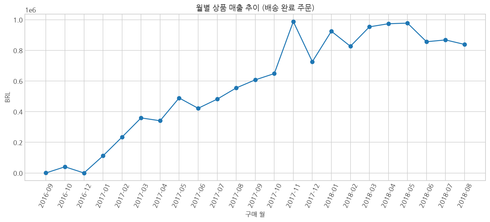
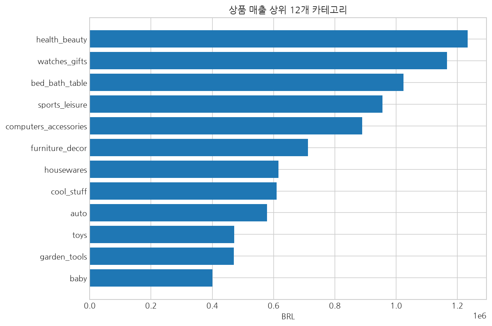
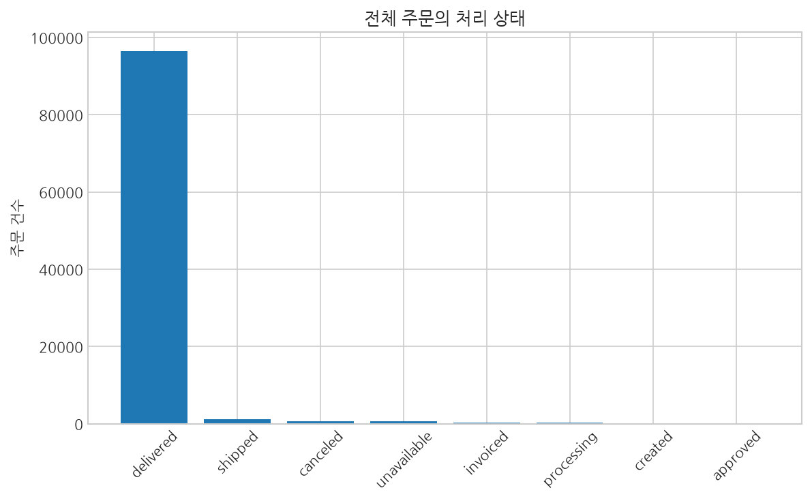
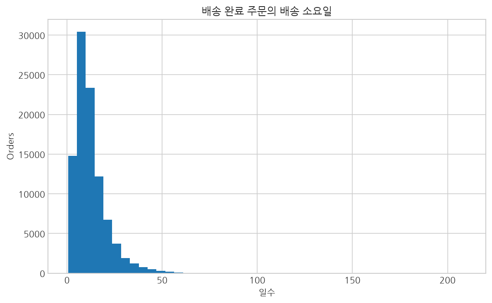
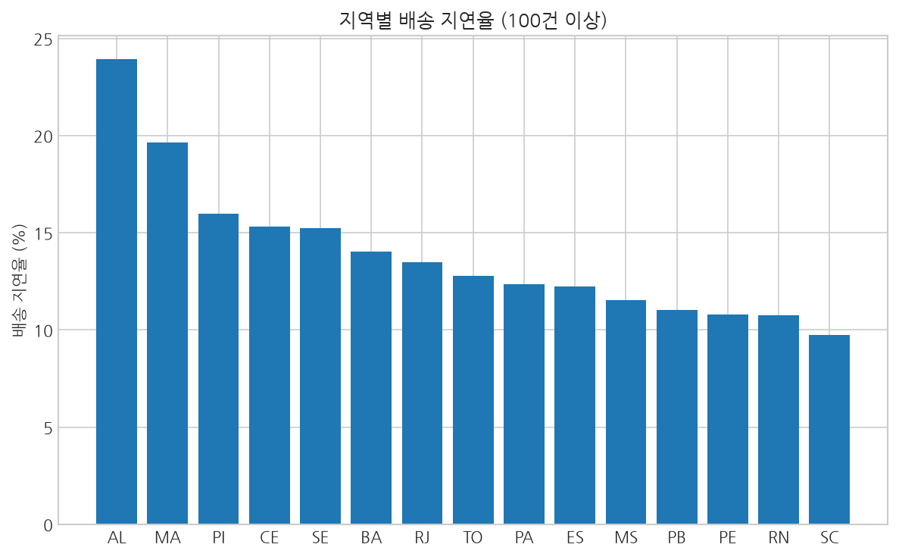
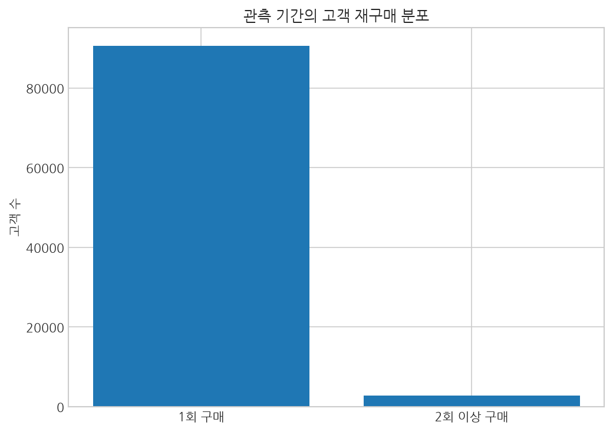
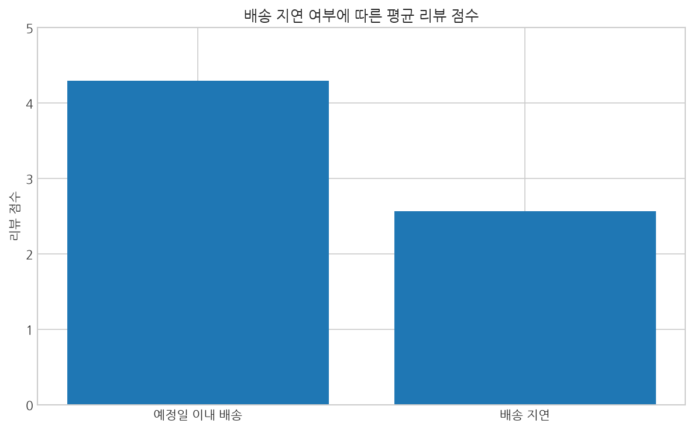

# Olist 실데이터 분석 결과

GitHub Actions에서 Kaggle 공개 Olist 데이터로 실행하고 자동 검증한 결과입니다.

## 확인된 지표

| 항목 | 측정값 |
|---|---:|
| 전체 주문 | 99,441건 |
| 배송 완료 주문 | 96,478건 |
| 배송 완료 주문의 고유 고객 | 93,358명 |
| 배송 완료 주문의 상품 매출 합계 | 13,221,498.11 BRL |
| 결제 금액 합계 | 15,422,461.77 BRL |
| 평균 배송 소요일 | 12.56일 |
| 배송 지연율 | 8.11% (분모 96,470건) |
| 관측 기간 재구매 고객 비율 | 3.00% (분모 93,358명) |

## 실제 데이터 시각화

### 월별 상품 매출

### 상위 상품 카테고리

### 주문 처리 상태

### 배송 소요일

### 지역별 배송 지연율

### 재구매 고객 분포

### 배송 지연과 리뷰 점수

## 분석상 주의점

- 상품 매출은 배송 완료 주문의 상품 가격 합계이며 순이익이나 재무상 확정 매출이 아닙니다.
- 재구매율은 관측 기간 내 재구매 비율로, 장기 유지율이 아닙니다.
- 배송 지연과 리뷰 평점의 관계는 인과성을 입증하지 않습니다.
